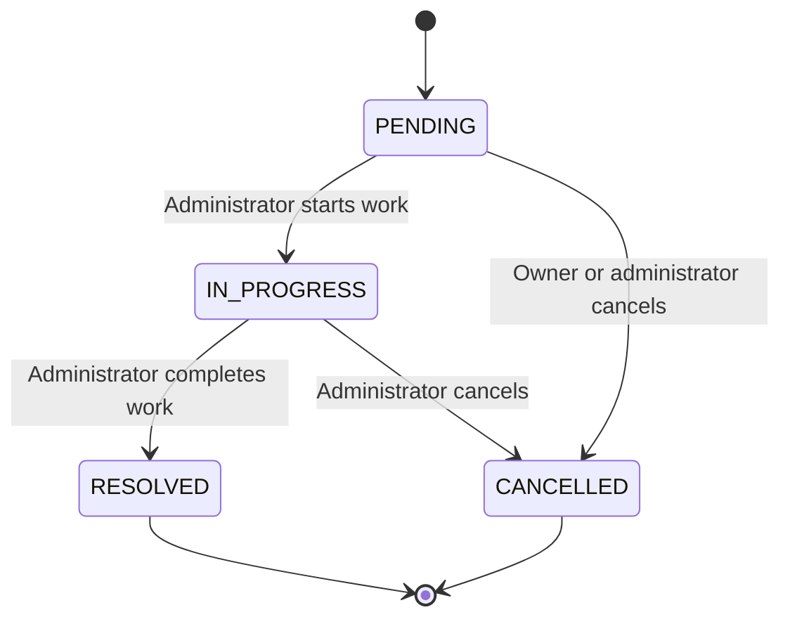
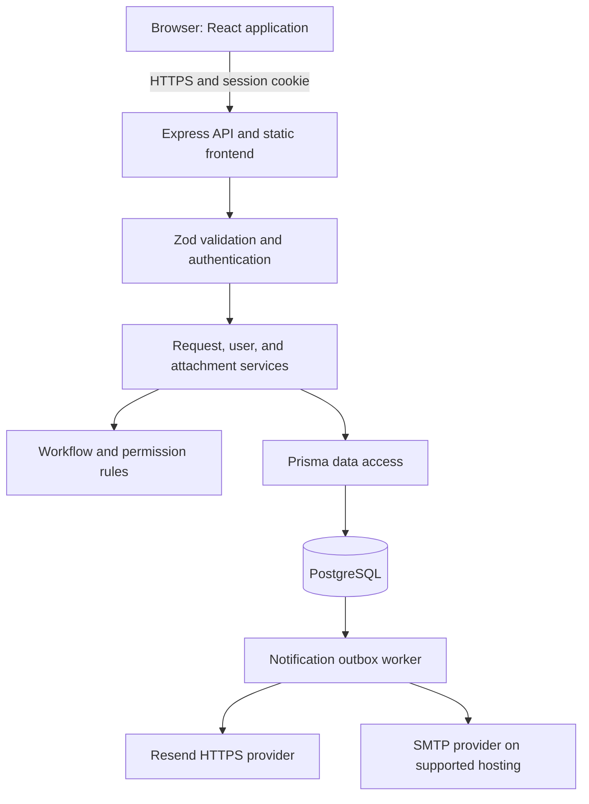

# Resolve — Service Request Management System

**Project implementation and deployment report**  
**Prepared:** 21 October 2026

| Item                    | Details                                                                                                                     |
| ----------------------- | --------------------------------------------------------------------------------------------------------------------------- |
| Project                 | Resolve — Service Request Management System                                                                                 |
| Live website            | [https://resolve-service-requests.onrender.com](https://resolve-service-requests.onrender.com)                              |
| GitHub repository       | [Dilanka-Bandara/Service-request-management-System-](https://github.com/Dilanka-Bandara/Service-request-management-System-) |
| Application type        | Full-stack web application with member and administrator roles                                                              |
| Hosting                 | Render Free Docker web service and managed PostgreSQL in Singapore                                                          |
| Implementation language | TypeScript across frontend and backend                                                                                      |

## 1. Project overview

I built and deployed a service request management application called **Resolve**. It gives users one place to submit problems or questions, attach supporting evidence, and follow progress. Administrators can review the request queue, update request statuses, and manage user access.

The project covers the complete application path: responsive frontend, authenticated API, relational database, business rules, file storage, notification delivery infrastructure, automated tests, container packaging, GitHub CI, and a public cloud deployment.

The application is suitable for an assignment demonstration of an internal help desk or support workflow. Its current free hosting configuration is intended for a demo; operational limitations are documented below.

## 2. What I implemented

### User accounts and access

- Registration and login with server-side sessions.
- Two roles: **member** and **administrator**.
- Registration always creates a member; a submitted role cannot grant administrator access.
- Members can view only their own requests.
- Administrators can view requests across the workspace and manage user roles and active status.
- Logout removes the current session. Deactivating an account revokes its sessions.
- Administrators cannot deactivate or demote themselves, and concurrent administration changes preserve an active administrator.

### Request management

- Create requests with a title, description, category, and priority.
- Categories: Technical, Billing, Account, and Other.
- Priorities: Low, Medium, and High.
- Owners can edit request content while the request is pending.
- Administrators can move requests through the permitted workflow.
- Cancellation preserves the record and its history instead of permanently deleting it.
- Every request has an activity timeline showing creation and subsequent changes, including optional administrator notes.



Resolved and cancelled requests are terminal. The API enforces these rules even if someone bypasses the interface.

### Dashboard and user experience

- Status totals and category distributions.
- Search by request title or description.
- Combined status, category, and priority filters.
- Sorting by creation date, update date, priority, or title.
- Pagination and adjustable page size.
- URL-based list state for shareable filtered views.
- Responsive desktop and mobile layouts, dark appearance, loading states, validation messages, toast feedback, and confirmations for consequential changes.
- A dedicated administrator member-management page.

### File attachments

I added authenticated upload and download support for PDF, PNG, and JPEG files. Each request permits **five files**, with a maximum size of **5 MiB per file**. The API checks file signatures, sanitizes filenames, and enforces request visibility before downloads.

Only the owner can add attachments, and only while the request is pending. Uploads lock the parent request while checking the attachment count so simultaneous requests cannot bypass the limit.

Files are stored as binary data in PostgreSQL. This avoids losing uploads when a cloud container restarts or is replaced. It also means database backups must include attachment data. This design is practical for a small demonstration; a larger system should use private object storage.

### Email notifications

I implemented notification creation for new requests and status changes using a **transactional outbox**. A notification record is committed in the same database transaction as the request change. A background worker attempts delivery separately, so a temporary email-provider failure does not discard the request update.

- **Resend over HTTPS:** supported for Render Free, where SMTP ports are blocked.
- **Nodemailer SMTP:** supported for local or other hosting environments.
- Failed delivery is retried with exponential backoff, up to ten attempts.
- Conditional worker leases reduce simultaneous processing of the same notification.
- Resend requests include an idempotency key based on the notification ID.

**Current boundary:** notification code and automated tests are complete, but real email delivery is not enabled or verified. `RESEND_API_KEY` and a verified `MAIL_FROM` still need to be configured privately in Render. Until then, messages remain queued. The worker also pauses when the free web service sleeps.

## 3. Technology stack and why I used it

Versions below identify the major versions used by the project manifests; `package-lock.json` records the exact installed dependency tree.

| Layer                  | Technology                                        | Responsibility and reason                                             |
| ---------------------- | ------------------------------------------------- | --------------------------------------------------------------------- |
| Runtime                | Node.js 22                                        | Runs the API, build tools, and notification worker                    |
| Language               | TypeScript 5, strict mode                         | Static checking across the frontend and backend                       |
| Frontend               | React 19                                          | Component-based interface and interactive forms                       |
| Frontend tooling       | Vite 6                                            | Development server and optimized production assets                    |
| Routing                | React Router 7                                    | Login, dashboard, request, and administrator routes                   |
| Server state           | TanStack Query 5                                  | Fetching, caching, mutation handling, and invalidation                |
| Forms                  | React Hook Form 7 and Zod 3                       | Form state and schema validation                                      |
| Styling                | Custom CSS                                        | Responsive Resolve design and dark appearance                         |
| Icons and feedback     | Lucide React and Sonner                           | Interface icons and toast notifications                               |
| HTTP API               | Express 5                                         | Routing, middleware, validation, and HTTP responses                   |
| Database               | PostgreSQL 16 in Render, Compose, and CI          | Relational integrity, transactions, and persistent storage            |
| Database access        | Prisma 7 with PostgreSQL adapter                  | Typed queries, client generation, and versioned migrations            |
| Password hashing       | Argon2id                                          | Password hashes instead of stored plaintext passwords                 |
| Sessions               | Random opaque tokens and SHA-256 hashes           | Revocable database sessions with protected browser cookies            |
| Upload handling        | Multer 2                                          | Bounded multipart file uploads                                        |
| Email                  | Nodemailer 10 and Resend HTTPS API                | SMTP and HTTPS delivery options                                       |
| Security middleware    | Helmet, CORS, express-rate-limit                  | Security headers, origin restrictions, and authentication rate limits |
| Logging                | Pino and pino-http                                | Structured logging with sensitive headers redacted                    |
| API documentation      | OpenAPI, Swagger UI, Zod-to-OpenAPI               | Documented API contracts and interactive exploration                  |
| Testing                | Vitest 5, Supertest, React Testing Library, jsdom | Domain, database-backed API, and component tests                      |
| Code quality           | ESLint and TypeScript                             | Linting and static correctness checks                                 |
| Formatting             | Prettier                                          | Consistent source and documentation formatting                        |
| Packaging              | npm workspaces and lockfile                       | One repository containing client and server packages                  |
| Containers             | Docker and Docker Compose                         | Repeatable application packaging and local services                   |
| Version control and CI | Git, GitHub, GitHub Actions                       | Reviewable changes and automated verification                         |
| Cloud hosting          | Render Blueprint                                  | Declarative web service and managed database configuration            |

The UI uses custom CSS and native category meters. It does not use Tailwind, shadcn, or Recharts. Express serves the built React application, so a separate nginx service is not required.

## 4. System architecture



During local development, Vite runs on port **5173** and proxies `/api` to Express on port **4000**. In the deployed container, Express serves both the React production files and the API from one origin. This simplifies cookie authentication and deployment.

Routes handle HTTP concerns and input validation. Services enforce business rules and transactions. Pure domain functions define permissions and status transitions. The request repository centralizes visibility filtering and query projections.

## 5. Database design and consistency

| Entity           | What it stores                                                               |
| ---------------- | ---------------------------------------------------------------------------- |
| `User`           | Name, unique normalized email, password hash, role, active state, timestamps |
| `Session`        | Hashed session token, user relationship, creation time, expiry               |
| `ServiceRequest` | Title, description, category, priority, status, owner, timestamps            |
| `RequestHistory` | Request, actor, action, old/new status, optional note, timestamp             |
| `Attachment`     | Request, filename, MIME type, size, binary content, timestamp                |
| `Notification`   | Recipient, subject, body, retry count, lease/retry time, delivery timestamp  |

The schema uses UUID primary keys, foreign keys, enums, unique constraints, and indexes for common lookups. Indexes support owner-specific requests, status queues, ordered history, session lookup, and pending notifications.

I handled concurrency explicitly: status changes condition on the previously read state, edits check the previous update timestamp, uploads serialize attachment-count checks, and administrator changes use a transaction-scoped advisory lock. Conflicting writes return an HTTP 409 instead of silently overwriting another change.

Schema changes are stored as committed Prisma migrations. The idempotent seed creates an administrator, two sample members, and 30 sample requests when the request table is empty. Re-running the seed preserves existing passwords.

## 6. Authentication, security, and secret handling

- Passwords are hashed with Argon2id.
- A login creates a 256-bit random opaque session token. Only its SHA-256 hash is stored in the database.
- The browser receives an `httpOnly`, `SameSite=Lax` cookie, with `Secure` enabled in production.
- Requests load the current user role and active state from the database.
- State-changing requests validate the origin and reject cross-site Fetch Metadata, including multipart uploads.
- JSON mutations require the correct content type; CORS is restricted to the configured frontend origin.
- Authentication endpoints have rate limits.
- Responses do not expose password hashes or server stack traces.
- Request logs redact cookies and authorization headers.
- Database public access is blocked by the Render Blueprint's empty IP allowlist.

I protected local secrets with `.gitignore` and `.dockerignore`. `.env` and its variants are excluded, while `.env.example` contains configuration placeholders. CI checks that private environment files are not tracked. Real passwords and provider keys are stored locally or in Render environment settings, never in this report.

## 7. Docker handling

### Multi-stage application image

I created a two-stage Dockerfile based on `node:22-bookworm-slim`:

1. **Build stage:** installs the required OpenSSL package, copies workspace manifests, installs locked dependencies with `npm ci`, copies source, builds both workspaces, and removes development dependencies using `npm prune --omit=dev`.
2. **Runtime stage:** copies production dependencies, server output, Prisma configuration and migrations, and built React assets. The process runs as the non-root `node` user.

The image declares port 4000. The application also accepts a `PORT` environment variable, including Render's assigned port. Startup runs migrations, optionally runs the demo seed when `SEED_ON_START=true`, and starts Express. A failed migration prevents normal application startup.

### Docker Compose

`docker-compose.yml` defines:

- A `postgres:16-alpine` database with a named persistent volume.
- A loopback-only local database port binding.
- An initialization script for the dedicated test database on a fresh volume.
- A `pg_isready` health check.
- An optional application service under the `full` profile, which waits for database readiness and reads local settings from `.env`.

```bash
# Run the database for local Node.js development
docker compose up -d db

# Build and run the application and database together
docker compose --profile full up --build
```

The full local container application is available at `http://localhost:4000`. Compose's example database credentials are for local development only; Render uses a generated managed database connection.

**Verification distinction:** Docker Desktop's Linux engine did not respond during local setup, so I used an isolated local PostgreSQL 17 instance for development verification. I do not claim a successful local Compose run. Render subsequently built and ran the Docker image successfully, verifying the cloud container path.

## 8. Hosting on the web with Render

**Hosted website: [https://resolve-service-requests.onrender.com](https://resolve-service-requests.onrender.com)**

I added `render.yaml` as an infrastructure Blueprint and deployed the GitHub repository to Render. The deployment uses:

| Setting             | Deployed configuration                                   |
| ------------------- | -------------------------------------------------------- |
| Web service         | `resolve-service-requests`                               |
| Runtime             | Docker                                                   |
| Web plan            | Free                                                     |
| Database            | Managed PostgreSQL 16, Free                              |
| Region              | Singapore                                                |
| Health check        | `/api/health`, including database connectivity           |
| Frontend/API        | Same HTTPS origin                                        |
| Database connection | Injected from the Blueprint-managed database             |
| Production mode     | `NODE_ENV=production`                                    |
| Proxy setting       | `TRUST_PROXY=true`                                       |
| Initial setup       | Migrations and idempotent demo seed at container startup |
| Credentials         | Private Render-generated seed passwords                  |

I set `CLIENT_ORIGIN` to the actual hosted origin and verified the service after deployment. Administrator login uses `admin@example.com`; its password is available privately as `SEED_ADMIN_PASSWORD` in the service's Render Environment page. Sample members are `alex@example.com` and `jamie@example.com`, using the private `SEED_USER_PASSWORD` value.

The free service sleeps after inactivity, so the first request may take around a minute. The current free database expires on **20 November 2026**. Data must be exported or the database upgraded before expiry if the demo needs to remain available. No paid hosting was selected.

## 9. API design and documentation

The API is organized under `/api`:

| Group                       | Main operations                                         |
| --------------------------- | ------------------------------------------------------- |
| `/auth`                     | Register, login, logout, current user                   |
| `/requests`                 | List, search/filter/sort, create, details, edit, cancel |
| `/requests/stats`           | Dashboard statistics                                    |
| `/requests/:id/status`      | Administrator workflow transition                       |
| `/requests/:id/attachments` | Authorized upload and download                          |
| `/users`                    | Administrator user listing and access management        |
| `/health`                   | Application/database readiness                          |
| `/docs`                     | Interactive Swagger documentation                       |

Successful responses use a `data` wrapper; paginated results also include `meta`. Errors have a consistent code, message, and optional details. The API distinguishes invalid inputs, authentication failures, forbidden actions, invisible resources, conflicts, oversized files, unsupported content types, and rate limits.

Supporting files include the [API reference](api.md), [exported OpenAPI schema](openapi.json), and [Postman collection](postman_collection.json).

## 10. Testing and quality assurance

The verified application baseline contains **65 passing automated tests: 60 backend and 5 frontend**.

Tests cover workflow state pairs, ownership and administrator permissions, password rules, registration and login, session revocation, request creation and filtering, audit/outbox writes, cancellation, concurrent updates, file validation, download authorization, cross-origin rejection, email retries, Resend delivery handling, and frontend validation and route protection.

Backend integration tests use a real PostgreSQL database named `srm_test`. The suite refuses a different database name to reduce the risk of clearing application data.

```bash
npm run lint
npm run typecheck
npm test
npm run build
```

GitHub Actions runs on pushes to `main` and pull requests. It provisions PostgreSQL 16, installs dependencies, applies migrations, lints, type-checks, runs tests, builds the application, audits dependencies at the high-severity threshold, and checks environment-file exclusions.

The application commit `75c0da8` passed [CI run 39480625375](https://github.com/Dilanka-Bandara/Service-request-management-System-/actions/runs/39480625375). A preceding 63-test baseline also passed from a fresh local clone.

On the hosted application, I verified:

1. Public health response: `{"data":{"status":"ok"}}`.
2. Administrator sign-in and the seeded dashboard.
3. Creation of a request named **Render deployment verification**.
4. Transition from Pending to In progress with an administrator note.
5. Persistence of the status and timeline after reloading the page.

Local browser checks also covered desktop and 360px mobile layouts. File handling has automated integration coverage; this report does not claim an additional hosted upload/download smoke test or real email receipt.

## 11. Git and repository organization

I organized the project as an npm-workspace monorepo and pushed the implementation to the supplied GitHub repository. Changes were divided into descriptive commits for tooling, API implementation, frontend work, tests, deployment, and documentation. Commit bodies explain the purpose and behavior of larger changes.

Examples include `feat(deploy): support Render Free and HTTPS email delivery` and `docs(deploy): document live Render demo and verification`.

```text
client/                 React application and component tests
server/src/             API, domain rules, services, middleware, documentation
server/prisma/          Database schema, migrations, and demo seed
server/tests/           Backend automated tests
docs/                   API, database, deployment, and verification documentation
scripts/                Database initialization and API export tooling
.github/workflows/      Automated CI configuration
Dockerfile              Multi-stage production application image
docker-compose.yml      Local database and optional full application stack
render.yaml             Render deployment Blueprint
.env.example            Safe configuration template
package-lock.json       Locked dependency tree
```

## 12. Current limitations and future improvements

| Area             | Current state / possible improvement                                                             |
| ---------------- | ------------------------------------------------------------------------------------------------ |
| Email delivery   | Provider key and verified sender remain to be configured and tested                              |
| Hosting lifetime | Free database expires on 20 November 2026; free web service sleeps when idle                     |
| Attachments      | Stored in PostgreSQL; object storage is preferable at larger scale                               |
| File safety      | Signature and size checks exist; antivirus scanning and content sanitization are not implemented |
| Account recovery | Password reset and email verification are not implemented                                        |
| Rate limiting    | Per-process memory; use a shared store when scaling to multiple instances                        |
| Email guarantees | SMTP is at-least-once; a crash after sending can cause duplicates                                |
| Search           | Case-insensitive substring search; full-text search is a future option                           |
| Operations       | Notification administration, backup automation, monitoring, and audit export can be expanded     |
| End-to-end CI    | Browser journeys were manually exercised; automated browser CI is a future improvement           |
| Submission video | A narrated demonstration video remains a project-owner submission task                           |

## 13. Short project explanation for a presentation

> I developed Resolve, a full-stack service request management system using React and TypeScript on the frontend, Express and Node.js on the backend, and PostgreSQL with Prisma for data storage. It supports member and administrator roles, authenticated sessions, request tracking, controlled status changes, audit history, file attachments, and queued email notifications. I packaged the application with a multi-stage Dockerfile, added automated checks through GitHub Actions, and deployed the container and a managed database on Render Free. I protected environment secrets from Git, verified the live login and request workflow, and documented the remaining email-provider setup and free-hosting limits. The live site is https://resolve-service-requests.onrender.com.

## 14. Supporting project documents

- [README and local setup](../README.md)
- [Technology decisions](TECH_STACK.md)
- [Database design](database.md)
- [API reference](api.md)
- [Render deployment runbook](deployment.md)
- [Verification evidence](verification.md)
