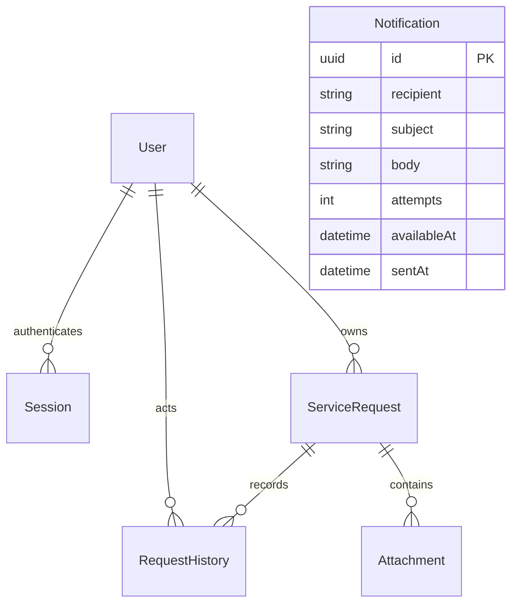

# Database design

All primary keys are UUIDs. Application timestamps are ISO UTC in API responses.

| Table            | Data and integrity                                                                                                                                             |
| ---------------- | -------------------------------------------------------------------------------------------------------------------------------------------------------------- |
| `User`           | Name, unique normalized email, Argon2id hash, role, active state, timestamps. Users are deactivated, not hard-deleted.                                         |
| `Session`        | Unique SHA-256 token hash, user foreign key, fixed expiry, creation time. Cascades if the user is deleted.                                                     |
| `ServiceRequest` | Title (120 chars), description, category/priority/status enums, owner, timestamps. Owner deletion is restricted.                                               |
| `RequestHistory` | Request, actor, action, optional old/new status and note (500 chars), timestamp. Actor deletion is restricted.                                                 |
| `Attachment`     | Request, sanitized filename (200 chars), detected MIME type, byte size, bounded binary content, creation time. API enforces five files/request and 5 MiB/file. |
| `Notification`   | Recipient, subject, plain-text body, attempts, lease/retry time, optional delivery timestamp. Created atomically with workflow changes.                        |

## Indexes

- Unique email supports account lookup and prevents duplicate registration.
- Unique token hash supports session authentication. Session user and expiry indexes support revocation and cleanup.
- `(createdById, createdAt)` supports member request listing.
- `(status, createdAt)` supports status queues; category and priority indexes support filtering.
- `(requestId, createdAt)` supports ordered history.
- Attachment request index supports metadata listings and bounded-count checks.
- `(sentAt, availableAt)` supports the outbox worker.

## Concurrency

Status updates condition on the previously read state. Content edits also check `updatedAt`. Every successful change inserts history in the same transaction. Uploads lock the parent request before counting attachments, preventing simultaneous uploads from exceeding the cap.

User administration takes a transaction-scoped advisory lock, rechecks the acting admin, then checks active-admin count. This serializes competing demotions/deactivations.

An outbox worker conditionally claims each notification with a two-minute lease. Failed sends use exponential backoff up to one hour, with a maximum of ten attempts. The worker does not promise exactly-once delivery.

## Migrations and seed

`server/prisma/migrations` is the authoritative schema history. `npm run db:migrate` applies committed migrations. The seed creates one admin, two members, and 30 example requests when the request table is empty; credentials come only from environment variables.

Production migrations never truncate tables. Only the integration test suite clears its dedicated `srm_test` database.
